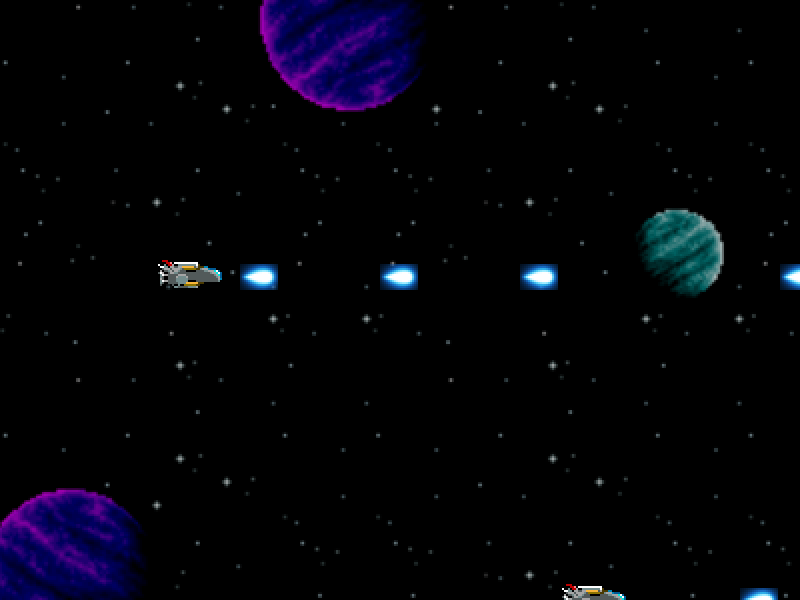
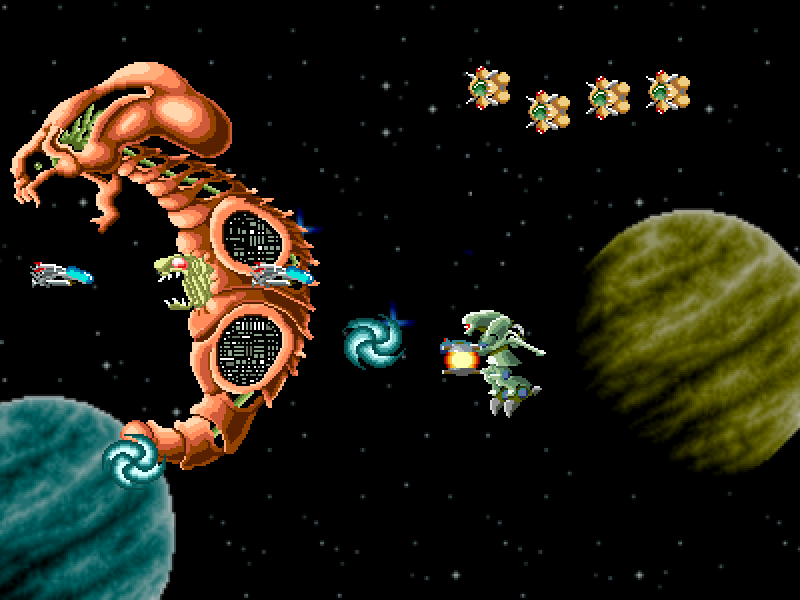
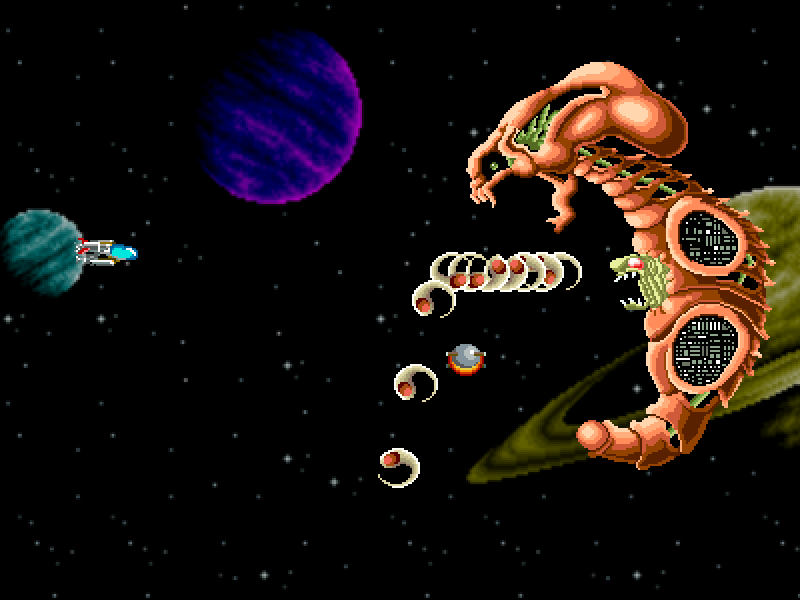

# R-Type — CactusEngine


A networked, multiplayer R-Type built on **CactusEngine**, a modular C++17 game engine written from scratch: ECS core, Lua scripting, JSON scenes and an authoritative UDP server.

Epitech 3rd-year project (team of 5, Nov 2024 – Jan 2025).

<p align="center">
  
  
  
</p>

## Highlights

- **ECS engine**: entity registry with component pools, tags, entity templates and a thread-safe registry (shared mutex) serialisable with cereal.
- **Pluggable modules**: Graphic, Audio, Inputs, Physics and Network, each compiled in or out with a CMake flag. The same game builds as a graphical client or as a headless server.
- **Lua gameplay**: all game logic (player, enemies, waves, boss, particles, scrolling) lives in Lua scripts bound through sol2, with hot scene reload.
- **Data-driven scenes**: entities, assets, inputs, animations and levels are described in JSON.
- **Networking**: client/server over UDP (asio), with a binary protocol (magic, version, type, length, checksum header + cereal payload). Clients send inputs and the server broadcasts world snapshots.
- **Tooling**: an engine editor (raygui) to place entities, edit templates and launch scenes, a Lua API doc generator, a GoogleTest target with lcov coverage, and ThreadSanitizer builds.

## Games included

| Game | Description |
| --- | --- |
| `Games/RType` | Side-scrolling shooter: two stages, enemy waves, a boss, bonuses, particles and sound |
| `Games/Pong` | Networked Pong, used as a minimal engine sample |
| `Games/SuperMario` | Platformer prototype (not wired into the build) |
| `Games/EngineEditor` | Visual scene editor |

## Architecture

```
Engine/
├── Core/            ECS (Registry, EntityManager, ComponentPool), scenes, events, Lua ScriptSystem
├── Modules/
│   ├── Graphic/     raylib rendering: sprites, textures, animations, text
│   ├── Audio/       music and sound effects
│   ├── Inputs/      keyboard / mouse / gamepad, input configs
│   ├── Physics/     Area2D and box colliders, collision callbacks
│   └── Network/     UDP client/server, packet protocol, snapshots
├── Test/            GoogleTest suite
└── Tools/DocGen/    Lua API documentation generator
Games/               games built on the engine (one executable per client/server)
```

A game is a few lines of C++. The rest is JSON and Lua:

```cpp
Engine engine;
engine.addModule<Graphic>("R-Type", 800, 600);
engine.addModule<Audio>();
engine.addModule<Inputs>();
engine.addModule<Physics>();
engine.addModule<Network>();
engine.loadScene("Games/RType/config/scene.json");
engine.run();
```

```lua
function init(e) self = e end

function update(dt)
    local pos = getPosition(self)
    if isInputActive(self, "Shoot", true) then
        local bullet = createEntity("Bullet")
        setPosition(bullet, { x = pos.x + 10, y = pos.y, z = 0 })
        playSoundEffect("Games/RType/assets/sounds/shoot.ogg", 2.0)
    end
end

function onCollide(other) end
```

More details in [Engine/README.md](Engine/README.md) (adding modules and bindings) and [Engine/ScriptingAndScene.md](Engine/ScriptingAndScene.md) (scene format and Lua API).

## Tech stack

C++17 · CMake · Conan 2 · [Task](https://taskfile.dev) · raylib · Lua 5.4 + sol2 · asio · cereal · nlohmann/json · Chipmunk2D · GoogleTest

## Build & run

Requirements: a C++17 compiler, CMake ≥ 3.23, Conan 2 and Task.

```bash
task install   # conan install (dependencies built if missing)
task cb        # build the R-Type and Pong clients  → ./Release
task sb        # build the R-Type and Pong servers  → ./Release
```

```bash
./Release/r-type_server   # listens on UDP 12345
./Release/r-type_client
```

The server address is currently hard-coded in `Engine/Modules/Network/src/Client/Client.cpp`. Change it before connecting to a remote server.

Other tasks: `task enginebuild` + `task ee` (editor), `task test` (tests + HTML coverage report), `task cb_tsan` (ThreadSanitizer build). Run `task --list` to see them all.

Targets Linux and macOS. `task bw` is the Windows build.

## Team

Aurélien Baraquin · Guillaume Tran · Victor Boudet · Louis Cornu · Mehrdad Zeinali

## License

[CC0 1.0](LICENSE). Sprites and sounds come from the original R-Type and belong to their owners.
