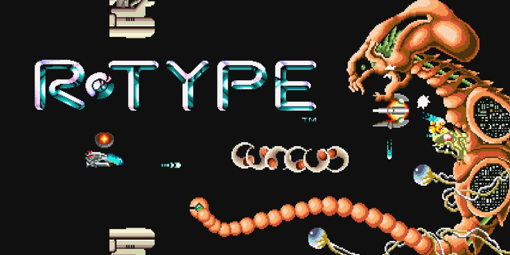

# R-Type



## Team members

- [Aurelien Baraquin](Aurelien.Baraquin@epitech.eu)
- [Guillaume Tran](Guillaume1.tran@epitech.eu)
- [Louis Cornu](Louis.cornu@epitech.eu)

Duration of the project : 2 months

## Description

The goal of this project is divided in 2 parts, firstly we have to create a game engine and then we have to create a clone of the game R-Type.

## Technologies used

- C++
- CMake
- Conan
- SDL2
- Sol2
- Lua
- SFML

## Supported platforms

- Windows 
- Linux
- MacOS
  

## Installation

make sure you have Conan and tasj installed on your machine, then run the following commands:

```bash
git clone git@github.com:EpitechPromo2027/B-CPP-500-MPL-5-2-rtype-guillaume1.tran.git

cd B-CPP-500-MPL-5-2-rtype-guillaume1.tran

conan install .

task cb

task crtype
```

## Architecture

The game engine project is a C++ project using ECS (Entity Component System) architecture, more information about ecs [here](https://en.wikipedia.org/wiki/Entity_component_system)

The engine is composed of components and modules, there are for now 5 modules:

- Network
- Graphics
- Input
- Physics
- Audio

Each module is composed of components.

## how to create your own game

Follow the documentation to add your modules for custom engine [here](Engine/README.md)

Follow the documentation to make your own game [here](Engine/ScriptingAndScene.md)


# TODO 

mettre, image, license, author, platforme supporté, task alternative, mettre dans githubpage read the docs -> html

plusieurs stages, boss, améliorations 


etude comparatives, doc network a comparer

